<p align="center">
  
</p>

<p align="center">
  <b>Tes films, séries et chaînes en direct, dans une vraie interface de TV.</b><br>
  Lecteur IPTV pour Android TV, projecteurs et Mac, par exr0.
</p>

<p align="center">
  <a href="https://github.com/alexrdg/prizm-releases/releases/latest/download/prizm.apk"><b>📺 Android TV (APK)</b></a>
  ·
  <a href="https://github.com/alexrdg/prizm-releases/releases/latest/download/Prizm.dmg"><b>💻 Mac (DMG)</b></a>
  ·
  <a href="https://prizm.exro.cool">Essayer la démo en ligne</a>
</p>

<p align="center">
  
</p>

> Prizm est un **lecteur** : il ne fournit aucun contenu. Il affiche celui de ton abonnement IPTV (compte **Xtream Codes** : adresse du serveur, identifiant, mot de passe).

---

## Quelle app ?

Prizm existe en **deux apps**, avec la même interface et le même catalogue. Elles se partagent tes réglages, tes listes et ta progression grâce au [compte Prizm](#3-le-compte-prizm-tv--mac), facultatif.

| | 📺 **Android TV** | 💻 **Mac** |
|---|---|---|
| Pour | TV Android / Google TV, boîtiers, projecteurs (et téléphones, tablettes Android) | Mac avec puce Apple (M1 et suivants) |
| Téléchargement | `prizm.exro.cool/apk` | `prizm.exro.cool/mac` |
| Se pilote avec | La télécommande | La souris, le trackpad et le clavier |
| Lecteur | Lecteur natif de la TV (Media3) | Lecteur Prizm dans la fenêtre, avec ffmpeg intégré |
| Connexion au compte Prizm | QR code à scanner avec ton téléphone | E-mail et mot de passe |
| Mises à jour | Réglages → Mise à jour | Réglages → Mise à jour |

---

## Sommaire

**[1. Prizm pour Android TV](#1-prizm-pour-android-tv)**
- [Installation](#installation)
- [Premier lancement](#premier-lancement)
- [Fonctionnalités](#fonctionnalités)
- [Configuration (Réglages)](#configuration-réglages)
- [Effets légers ou complets](#effets-légers-ou-complets)
- [Télécommande : les touches](#télécommande--les-touches)
- [Mises à jour (TV)](#mises-à-jour-tv)

**[2. Prizm pour Mac](#2-prizm-pour-mac)**
- [Installation sur Mac](#installation-sur-mac)
- [Première ouverture : l’autorisation de macOS](#première-ouverture--lautorisation-de-macos)
- [Ce qui change sur Mac](#ce-qui-change-sur-mac)
- [Le lecteur sur Mac](#le-lecteur-sur-mac)
- [Raccourcis clavier](#raccourcis-clavier)
- [Mises à jour (Mac)](#mises-à-jour-mac)

**[3. Le compte Prizm (TV + Mac)](#3-le-compte-prizm-tv--mac)**
- [Ce qui est synchronisé](#ce-qui-est-synchronisé)
- [Créer ton compte](#créer-ton-compte)
- [La phrase secrète](#la-phrase-secrète)
- [Connecter la TV (QR code)](#connecter-la-tv-qr-code)
- [Connecter le Mac](#connecter-le-mac)
- [Appareils connectés](#appareils-connectés)

**[Questions fréquentes](#questions-fréquentes)**

---

# 1. Prizm pour Android TV

## Installation

### Sur Android TV, un boîtier ou un projecteur (avec Downloader)

1. Installe l’app **Downloader** (by AFTVnews) depuis le Play Store de la TV.
2. Dans Downloader, saisis cette adresse :

   ```
   https://github.com/alexrdg/prizm-releases/releases/latest/download/prizm.apk
   ```

   Elle pointe toujours vers la dernière version (raccourci : `prizm.exro.cool/apk`).
3. Android demande d’autoriser Downloader à installer des applications : accepte, puis **Installer**.
4. Prizm apparaît dans la rangée des applications de la TV.

> **À retenir :** pour mettre à jour, installe **par-dessus** l’app existante. Ne désinstalle jamais Prizm avant : c’est la désinstallation qui efface tes comptes, réglages, listes et progression. Depuis la 0.1.3, la mise à jour se fait directement depuis l’app (voir [Mises à jour](#mises-à-jour)).

### Configuration requise

- Android 7 ou plus récent (Android TV, Google TV, boîtier ou projecteur Android, tablette, téléphone).
- Un abonnement IPTV compatible **Xtream Codes**.
- Facultatif : une clé **TMDB** gratuite pour les affiches HD, le casting et les filmographies.

---

## Premier lancement

<p align="center">
  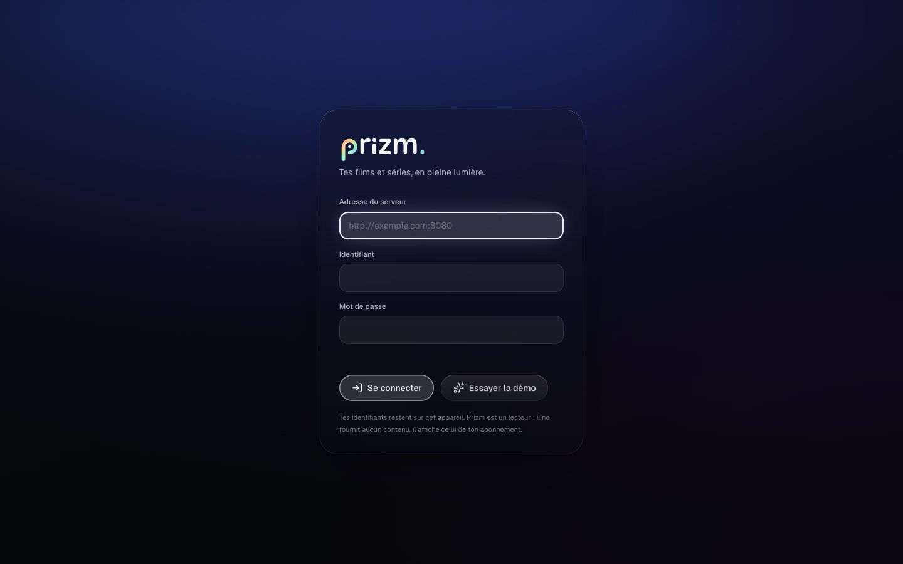
</p>

1. Saisis l’**adresse du serveur** (par exemple `http://exemple.com:8080`), ton **identifiant** et ton **mot de passe**, puis **Se connecter**.
   Pas encore d’abonnement ? **Essayer la démo** ouvre un catalogue d’exemple.
2. Prizm charge tout ton catalogue **une seule fois** : films, séries, catégories et chaînes. L’écran de préparation montre où il en est (« 13 099 · 32 % », puis « x / y » aux rechargements suivants).

<p align="center">
  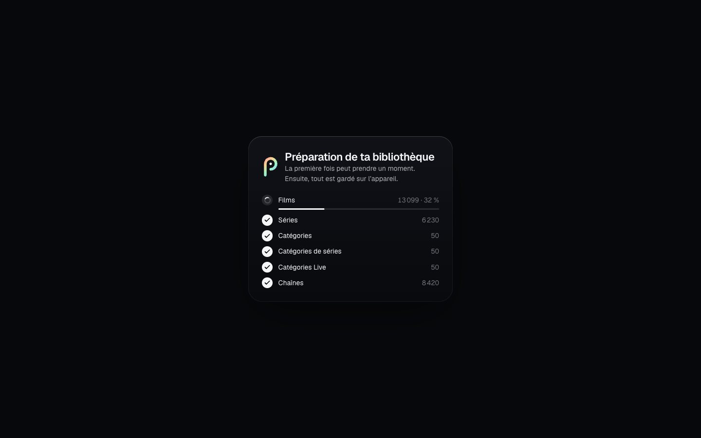
</p>

Ensuite, tout est gardé sur l’appareil : l’app démarre vite et ne recharge rien toute seule. Quand ton fournisseur ajoute des titres : **Réglages → Données → Recharger les données**.

> Même avec des dizaines de milliers de films, le chargement se fait en flux sur la TV : seules les informations utiles sont gardées.

---

## Fonctionnalités

### Accueil

- **À la une** : un bandeau de cinq titres choisis pour toi (bien notés, récents, proches de tes goûts). La sélection est gardée pour la journée, et le bandeau ne change pas tant que tu parcours les rangées.
- **Continuer** : les films et épisodes commencés (à partir de 3 minutes de visionnage), pour reprendre là où tu t’es arrêté.
- **À regarder**, **Favoris**, les **personnes que tu suis**, les nouveautés et les catégories de ton fournisseur.
- Le **menu** s’ouvre en allant à gauche. Aller à droite (ou **Retour**) le referme et te remet exactement où tu étais.

<p align="center">
  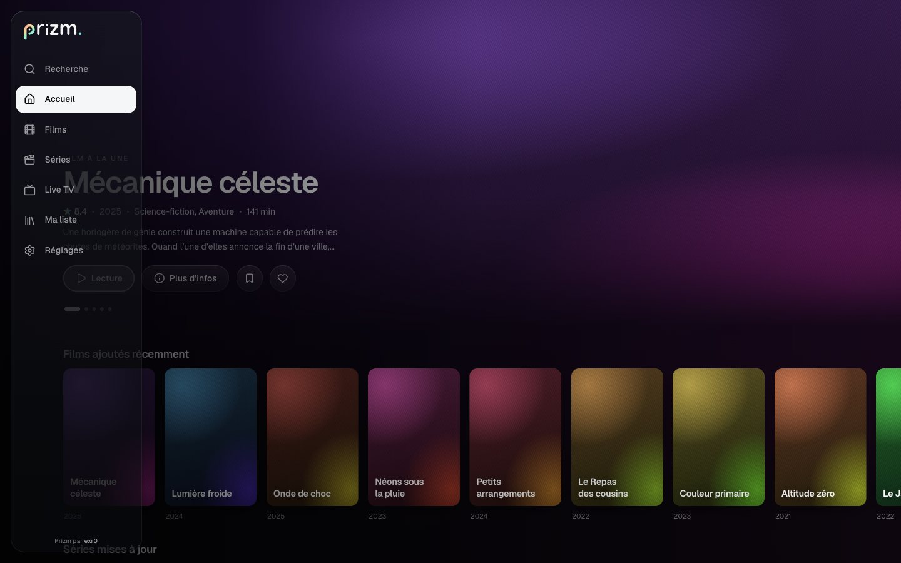
</p>

### Films et séries

- Toutes les catégories de ton fournisseur, en pastilles.
- **Tris à trois états** : un clic dans le sens habituel (ajouts récents, mieux notés, années récentes, A → Z), un deuxième dans le sens inverse, un troisième pour revenir à l’ordre du fournisseur. Une flèche indique le sens.
- Avec une clé TMDB, **Mieux notés** tient compte du nombre de votes : un film noté par trois personnes ne passe pas devant un classique.

<p align="center">
  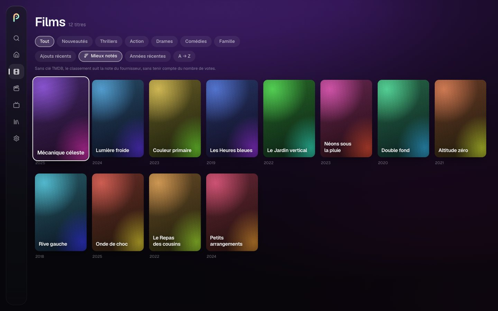
</p>

### Fiches, casting et filmographies

- Résumé, durée, classification, pays, réalisation, scénario, bande-annonce.
- Un bouton principal qui sait où tu en es : **Lecture**, **Reprendre · 42 min restantes**, ou pour une série **Regarder S1 · É3** (l’épisode après celui que tu as fini).
- Saisons et épisodes, avec la progression de chacun.
- **Distribution**, et des rangées « Du même réalisateur », « Avec… » tirées de ton catalogue.

<p align="center">
  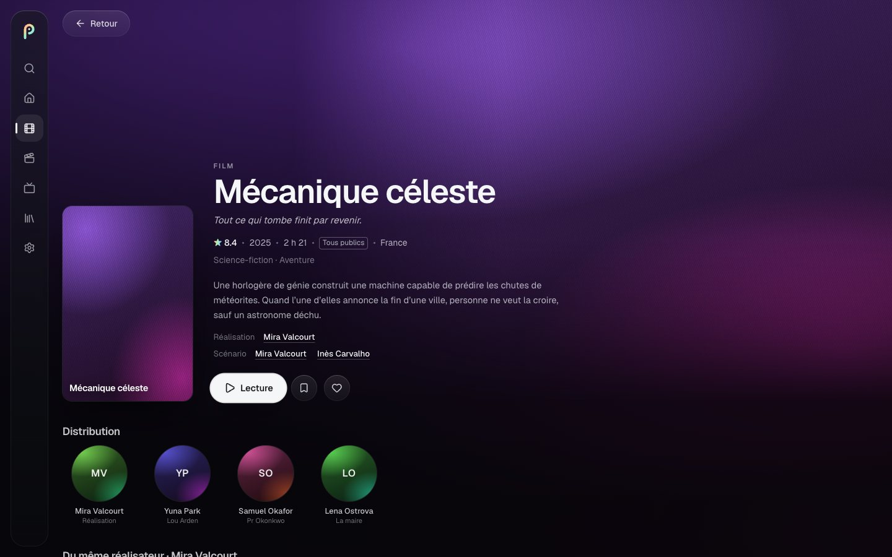
  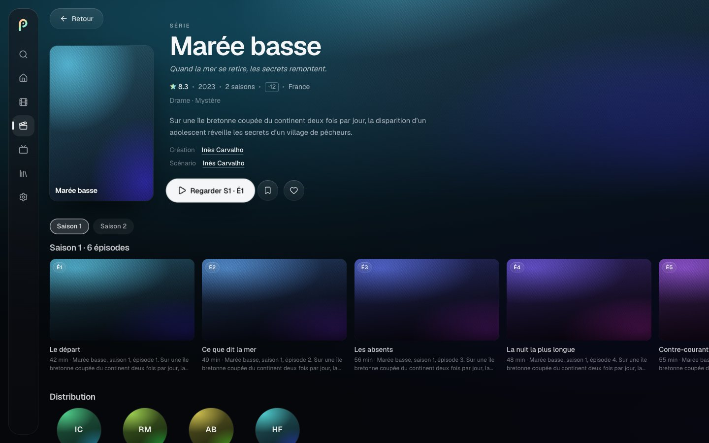
</p>

- Fiche **personne** : biographie, ce qui est disponible chez ton fournisseur, puis la **filmographie complète**. Un titre hors catalogue peut être ajouté à « À regarder » : il sera retrouvé s’il arrive chez ton fournisseur. **Suivre** une personne ajoute sa rangée sur l’accueil.

<p align="center">
  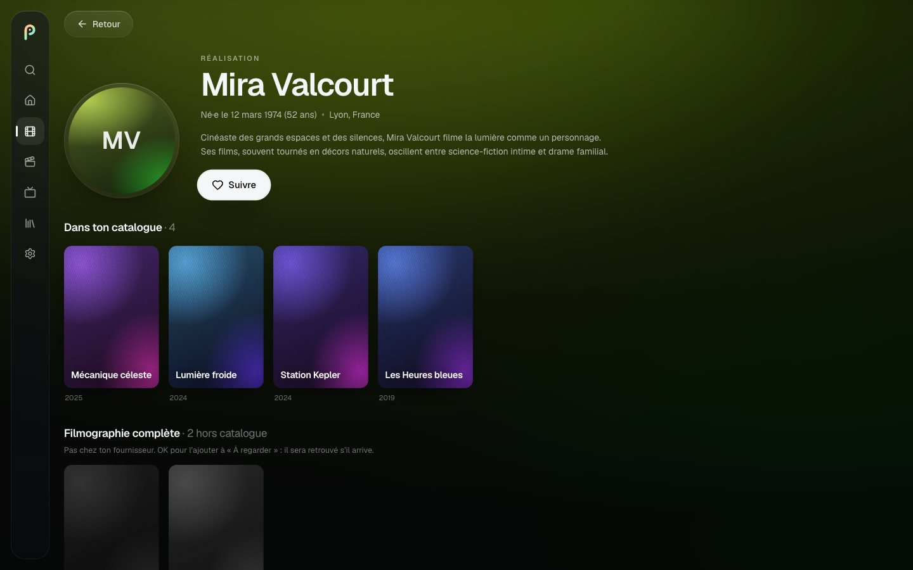
</p>

### Live TV

<p align="center">
  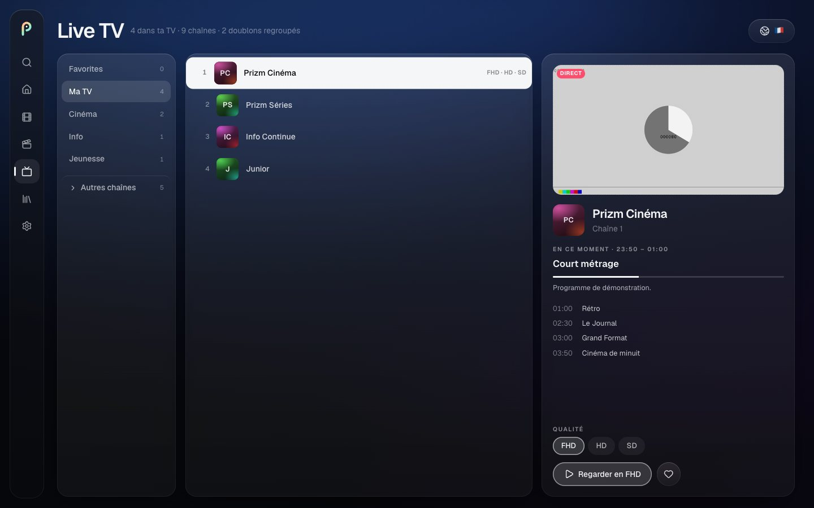
</p>

- **Ma TV** : choisis tes pays, Prizm en fait un bouquet numéroté comme à la maison (TF1 en 1, France 2 en 2…). Le reste est rangé dans **Autres chaînes**, jamais caché.
- **Doublons regroupés** : une même chaîne en SD, HD, FHD ou 4K devient une seule entrée ; tu choisis la qualité dans l’aperçu.
- **Aperçu vidéo** (en effets complets), programme en cours et à venir, **chaînes favorites**.

### Le lecteur

Films, épisodes et direct sont lus par le **lecteur natif de la TV** (Media3) : le décodage se fait sur la puce de la TV, y compris l’audio AC3/E-AC3 des fichiers mkv.

<p align="center">
  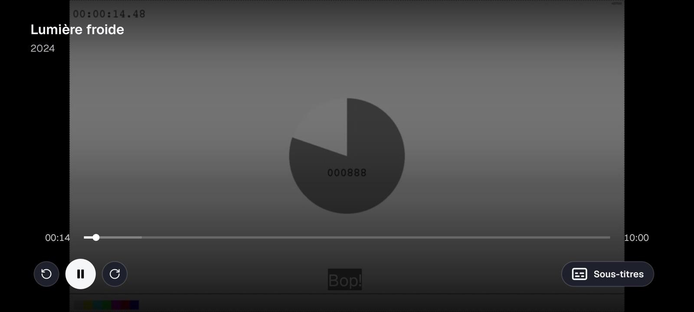
</p>

- Des contrôles sobres, pensés pour un grand écran : reculer, lecture, avancer.
- **Audio et sous-titres** : un panneau sur le côté, avec la langue de chaque piste écrite en clair (« Français », « Anglais · 5.1 », « Désactivés »). Le bouton n’apparaît que s’il y a un choix à faire.

<p align="center">
  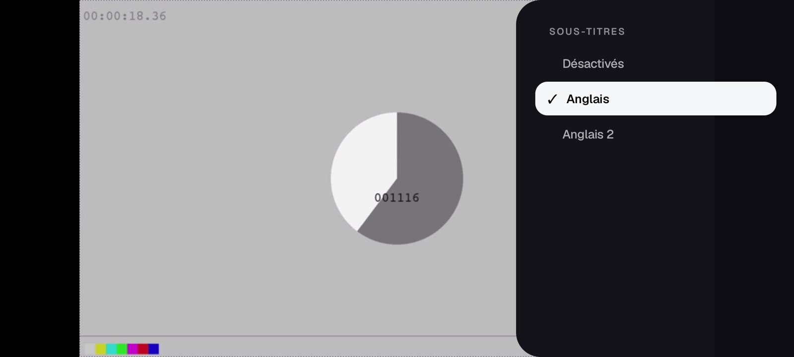
</p>

- **Épisode suivant**, façon Netflix : le bouton apparaît pendant le générique (OK pour lancer, Retour pour finir le générique), puis se remplit et enchaîne tout seul en fin d’épisode. Il est aussi dans les contrôles, pour passer à l’épisode suivant à tout moment.

<p align="center">
  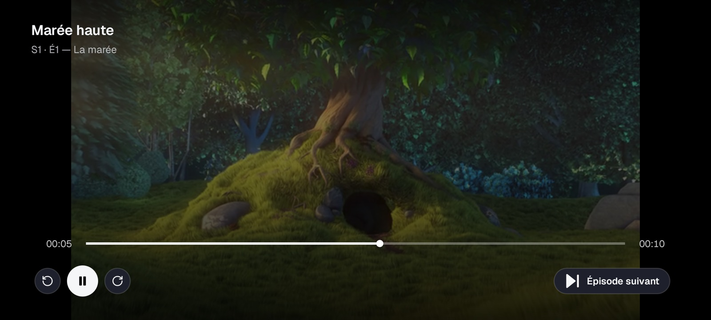
  
</p>

- **Direct** : zapping sans quitter le lecteur, avec un bandeau qui montre le numéro, la chaîne et le **programme en cours**. La pastille **Qualité** (FHD, HD…) change de version. Si un flux tombe, Prizm bascule tout seul sur une autre version ; s’il prend du retard, il repart au direct.

<p align="center">
  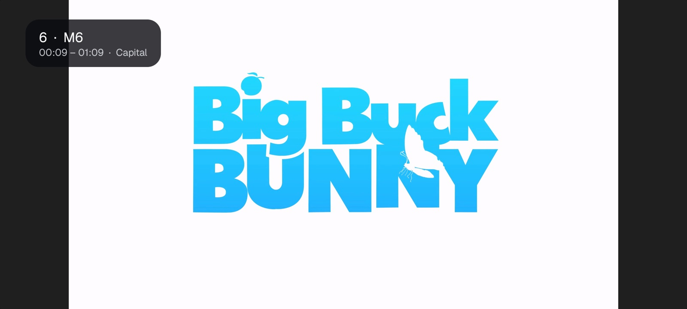
  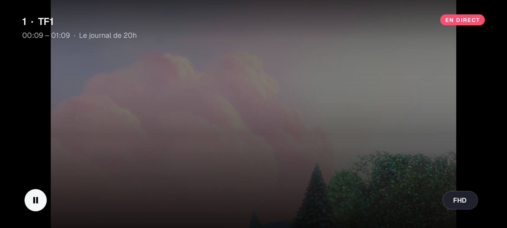
</p>

### Recherche et Ma liste

- **Recherche** dans tout le catalogue (titres, acteurs, réalisateurs, chaînes), sans tenir compte des accents.
- **Ma liste** regroupe **À regarder**, **Favoris** et les **Personnes** suivies.

<p align="center">
  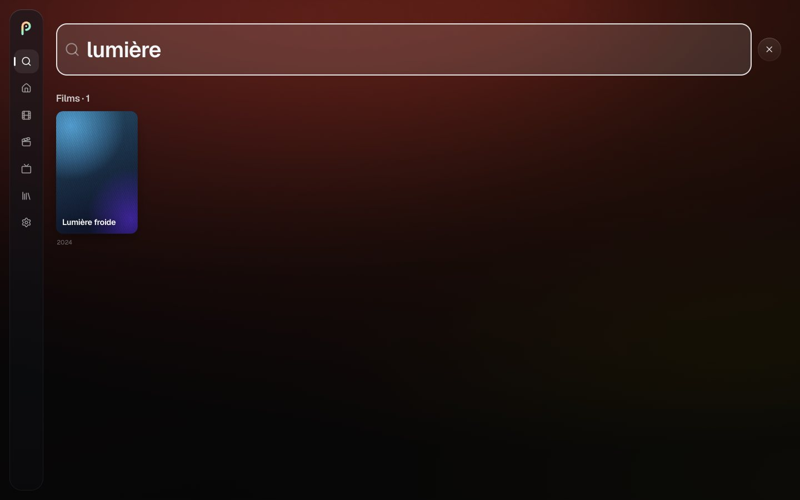
  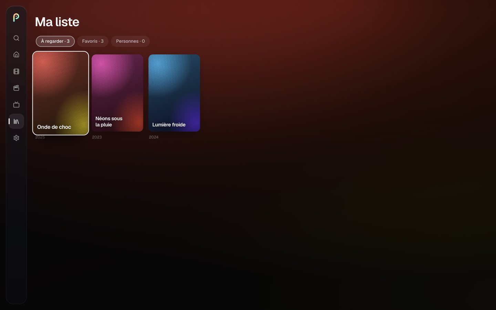
</p>

### Aussi sur téléphone et tablette

La même app s’adapte : le menu devient une barre en bas, les pages passent en colonne.

<p align="center">
  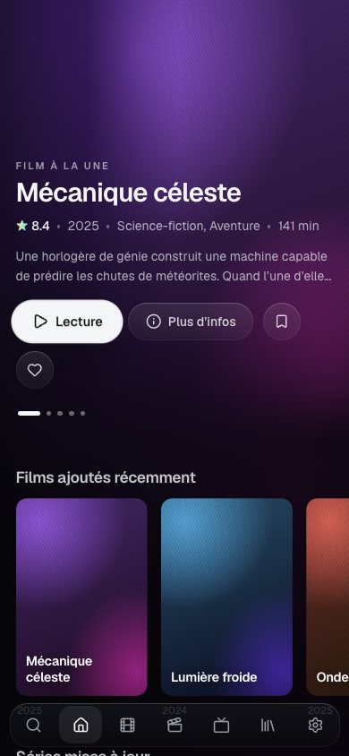
  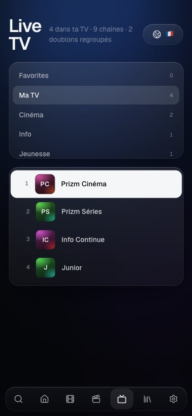
</p>

---

## Configuration (Réglages)

<p align="center">
  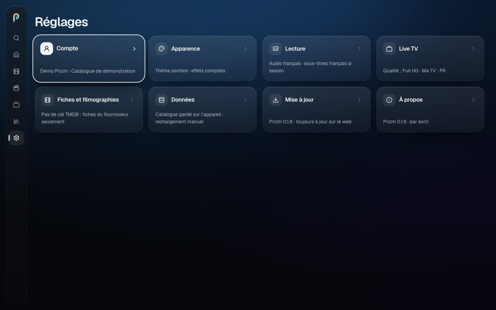
</p>

| Rubrique | Ce qu’on y règle |
|---|---|
| **Compte Prizm** | Se connecter à ton [compte Prizm](#3-le-compte-prizm-tv--mac), synchroniser, phrase secrète, appareils connectés. |
| **Compte Xtream** | Changer de compte, ajouter un compte, se déconnecter, oublier un compte. Chaque compte a ses propres listes et sa propre progression. |
| **Apparence** | Thème (sombre, clair, comme le système), [effets légers ou complets](#effets-légers-ou-complets), outils de diagnostic. |
| **Lecture** | Langue audio, langue et affichage des sous-titres, taille des sous-titres (détails ci-dessous). |
| **Live TV** | Qualité lancée par défaut (la meilleure, Full HD, HD, SD), et « Recomposer Ma TV » pour changer de pays. |
| **Fiches et filmographies** | La clé TMDB (facultative). |
| **Données** | Recharger le catalogue, ou vider le cache. |
| **Mise à jour** | Installer la dernière version de Prizm. |
| **À propos** | Version et mentions. |

### Lecture : langues et sous-titres

<p align="center">
  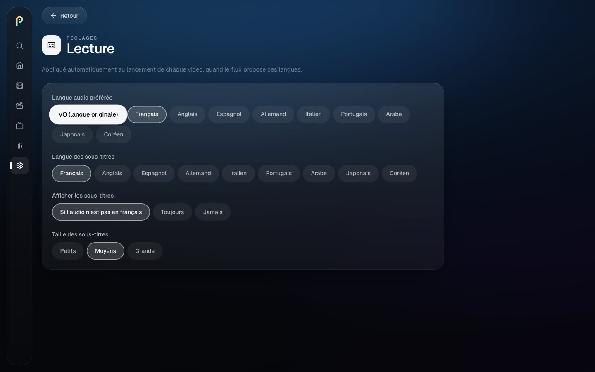
</p>

- **Langue audio préférée** : une langue, ou **VO (langue originale)**. Avec la VO, Prizm prend la langue d’origine du film, connue grâce à TMDB. Sans clé TMDB, il prend la piste annoncée « VO », sinon la première qui n’est pas en français.
- **Langue des sous-titres**, puis **Afficher les sous-titres** :
  - **Si l’audio n’est pas en français** (recommandé) : un film anglais en VO a des sous-titres français, un film français n’en a pas ;
  - **Toujours** ou **Jamais**.
- **Taille des sous-titres** : petits, moyens ou grands.

> Les fournisseurs étiquettent souvent mal leurs pistes (code vide, ou langue écrite seulement dans le nom : « VFF », « English 5.1 », « VOSTFR »). Prizm lit le code **et** le nom de chaque piste pour choisir la bonne. Tu peux toujours changer pendant la lecture, dans **Audio et sous-titres**.

### Clé TMDB (facultative, gratuite)

Elle apporte les affiches et images HD, les photos du casting, les filmographies complètes, les titres similaires, le classement par note pondérée et la langue originale (pour la VO).

1. Crée un compte sur [themoviedb.org](https://www.themoviedb.org).
2. **Paramètres → API** : copie la clé (v3) ou le jeton d’accès (v4).
3. Dans Prizm : **Réglages → Fiches et filmographies**, colle la clé, puis **Enregistrer**.

### Live TV : composer « Ma TV »

1. Ouvre **Live TV** : la première fois, Prizm propose les pays trouvés chez ton fournisseur.
2. Choisis-en un ou plusieurs, puis **Créer ma TV**.
3. Pour changer plus tard : le bouton des drapeaux en haut de Live TV, ou **Réglages → Live TV → Recomposer Ma TV**.

### Données

<p align="center">
  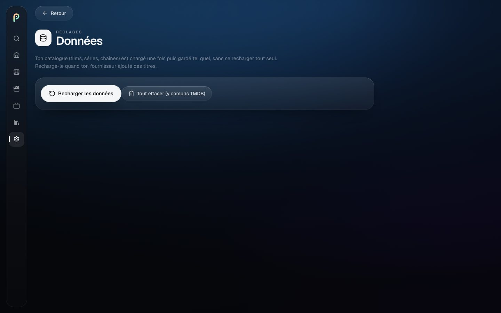
</p>

- **Recharger les données** : retélécharge films, séries et chaînes. Les fiches TMDB, longues à reconstituer, sont gardées.
- **Tout effacer (y compris TMDB)** : vide aussi le cache TMDB. Tes comptes, réglages, listes et progression ne sont **pas** touchés.

---

## Effets légers ou complets

<p align="center">
  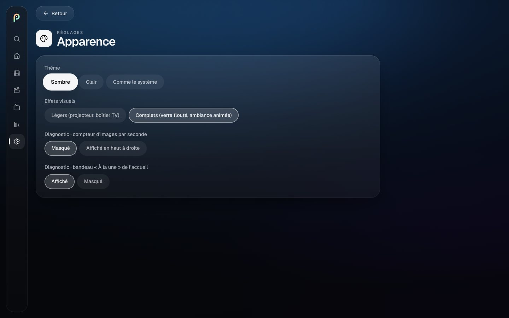
</p>

**Réglages → Apparence → Effets visuels.** C’est le réglage qui compte le plus pour la fluidité.

| | **Légers** (projecteur, boîtier TV) | **Complets** (verre flouté, ambiance animée) |
|---|---|---|
| Pour qui | Projecteurs, boîtiers et TV d’entrée de gamme | Appareils puissants, ordinateur |
| Fond | Dégradé fixe | Image du titre sélectionné, floue, qui suit ta navigation |
| Panneaux | Sombres et opaques | Verre dépoli translucide |
| Aperçu vidéo du Live | Coupé | Activé |
| Lecteur | Boutons opaques, aucune animation | Boutons translucides, léger grossissement au focus, fondu des contrôles |
| Par défaut | **Sur Android (TV, projecteur)** | Sur ordinateur |

<p align="center">
  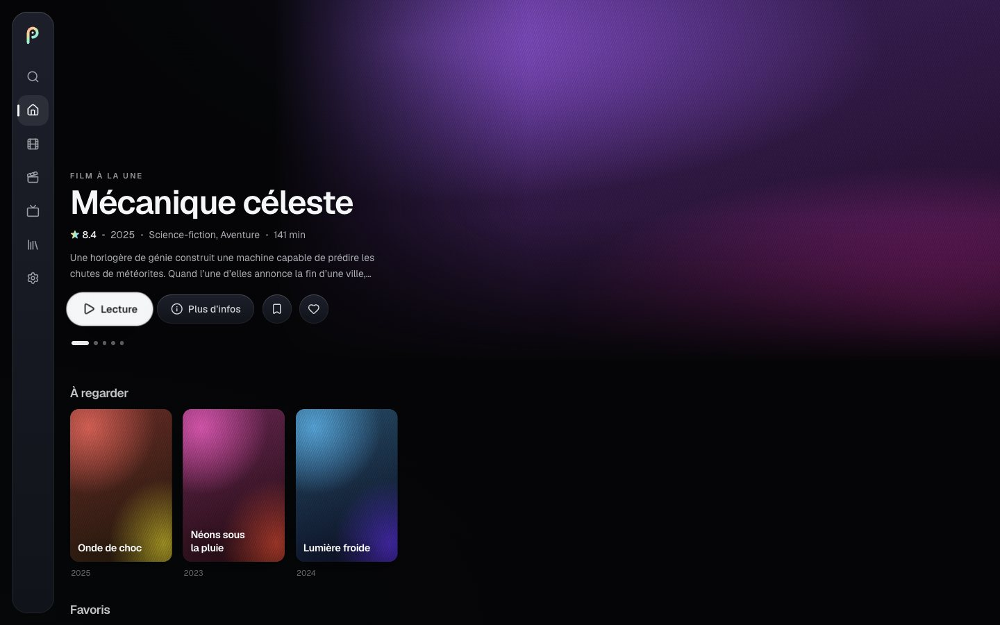
  
  <br><sub>À gauche : effets légers. À droite : effets complets.</sub>
</p>

**Conseil :** commence en **Légers**. Si la navigation est parfaitement fluide, essaie **Complets**, et reviens en arrière au moindre ralentissement.

### Diagnostic de fluidité

Toujours dans **Apparence** :

- **Compteur d’images par seconde** : une pastille en haut à droite, par exemple « 58 i/s · pire 24 ms ». Plus « pire » est bas, plus c’est fluide : sous 50 ms, la navigation est agréable ; au-delà de 200 ms, elle rame.
- **Bandeau « À la une »** : le masquer pour comparer la fluidité de l’accueil.

---

## Télécommande : les touches

| Où | Touche | Effet |
|---|---|---|
| Partout | Flèches, OK | Naviguer, valider |
| Partout | Retour | Revenir en arrière (ferme d’abord un panneau ou le menu) |
| Contenu | Gauche, depuis le bord | Ouvrir le menu |
| Menu | Droite ou Retour | Refermer le menu et revenir où tu étais |
| Lecteur | OK, haut, bas | Afficher les contrôles |
| Lecteur | Gauche, droite (sur la barre) | Reculer, avancer |
| Direct | Haut, bas, CH+, CH− | Chaîne suivante, précédente |
| Direct | Chiffres | Aller au numéro de « Ma TV » |
| Direct | 0 ou « dernière chaîne » | Revenir à la chaîne précédente |
| Direct | Info, Guide | Afficher le bandeau de la chaîne |
| Fin d’épisode | OK | Lancer l’épisode suivant tout de suite |

---

## Mises à jour (TV)

Depuis la 0.1.3 : **Réglages → Mise à jour**. Un point rose sur l’icône Réglages signale une nouvelle version.

1. **Installer la 0.1.x** : Prizm télécharge la mise à jour, avec une barre de progression.
2. **La première fois seulement**, Android demande d’autoriser Prizm à installer des applications : active l’option, reviens dans Prizm, relance l’installation.
3. Android propose **Mettre à jour** : accepte. Prizm redémarre dans la nouvelle version, **avec toute ta configuration** (comptes, clé TMDB, langues, listes, favoris, progression).

Les notes de chaque version sont sur la page [Releases](https://github.com/alexrdg/prizm-releases/releases).

---

---

# 2. Prizm pour Mac

<p align="center">
  
</p>

L’app Mac reprend **toute l’interface de la TV** : accueil, films et séries, fiches et filmographies, Live TV, recherche, Ma liste et réglages. Tout ce qui est décrit dans [Fonctionnalités](#fonctionnalités) et [Configuration](#configuration-réglages) vaut aussi sur Mac. Cette partie ne détaille que ce qui change.

## Installation sur Mac

1. Télécharge **[Prizm.dmg](https://github.com/alexrdg/prizm-releases/releases/latest/download/Prizm.dmg)** (raccourci : `prizm.exro.cool/mac`).
2. Ouvre le fichier, puis glisse **Prizm** dans le dossier **Applications**.
3. Lance Prizm depuis le Launchpad ou le dossier Applications.

**Configuration requise** : un Mac avec puce Apple (M1, M2, M3, M4…) et macOS 12 Monterey ou plus récent. Tout est intégré (y compris ffmpeg), rien d’autre à installer.

## Première ouverture : l’autorisation de macOS

Prizm n’est pas signé par Apple (c’est un projet perso, sans compte développeur Apple payant). La **première fois**, macOS refuse de l’ouvrir avec un message du type « Apple n’a pas pu confirmer que Prizm.app ne contenait pas de logiciel malveillant ». Pour l’autoriser :

1. Ferme le message (**Terminé**).
2. Ouvre **Réglages Système → Confidentialité et sécurité**.
3. Tout en bas, à côté de « L’ouverture de Prizm a été bloquée », clique sur **Ouvrir quand même**, puis confirme avec ton mot de passe ou Touch ID.

C’est à faire **une seule fois** : ensuite Prizm s’ouvre normalement, et les mises à jour faites depuis l’app ne le redemandent pas.

> Si le bouton n’apparaît pas, tente une nouvelle ouverture de Prizm puis retourne dans le réglage (il reste affiché environ une heure). Autre solution, dans le Terminal : `xattr -cr /Applications/Prizm.app`

## Ce qui change sur Mac

<p align="center">
  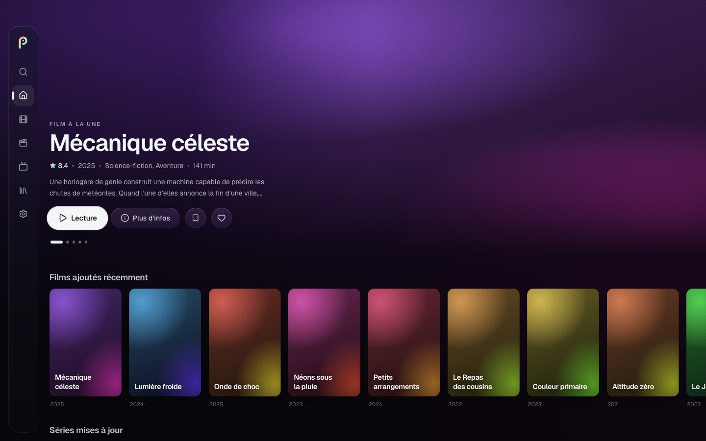
</p>

- **Premier lancement** : saisis ton compte Xtream comme sur la TV, ou choisis **J’ai un compte Prizm** pour récupérer tes comptes Xtream déjà enregistrés (voir [Connecter le Mac](#connecter-le-mac)).
- **À la souris** : un clic sélectionne ; survoler un champ ne le sélectionne pas. Le menu de gauche s’ouvre au survol et se replie dès que la souris le quitte.
- **La fenêtre** : se déplace par sa bande du haut, comme n’importe quelle app, et se redimensionne librement. Le bouton vert (ou **F** dans le lecteur) passe en plein écran.
- **Effets complets** par défaut (verre flouté, ambiance animée) : un Mac les affiche sans effort.

## Le lecteur sur Mac

<p align="center">
  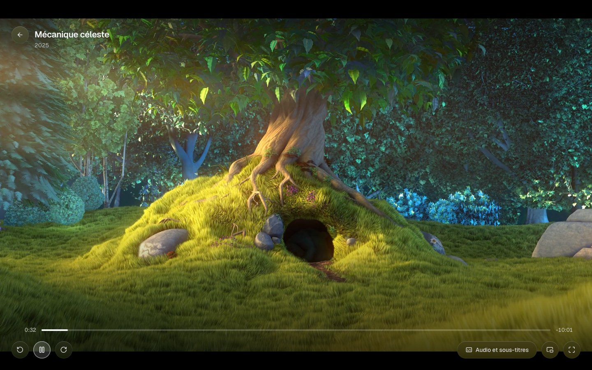
</p>

- La vidéo se lit **dans la fenêtre de Prizm**, pas en plein écran forcé : c’est la fenêtre que tu mets en plein écran si tu veux.
- **Tous les formats** : les fichiers que le Mac ne lit pas tels quels (son **AC3, E-AC3, DTS**, fichiers à **plusieurs pistes audio** ou avec **sous-titres intégrés**) sont convertis à la volée par ffmpeg, intégré à l’app. L’image n’est pas recompressée, seul le son est converti : aucune perte visible.
- **Audio et sous-titres**, **épisode suivant**, **zapping du direct** : comme sur la TV. Le panneau des pistes se ferme d’un clic à côté, ou tout seul après quelques secondes.
- **Image dans l’image** (bouton ou **P**) : la vidéo continue dans une petite fenêtre au-dessus de tes autres apps.
- **Plein écran** (bouton ou **F**).

## Raccourcis clavier

| Où | Raccourci | Effet |
|---|---|---|
| Partout | ⌘F | Recherche |
| Partout | ⌘, | Réglages |
| Partout | Échap, ⌘[ | Revenir en arrière |
| Partout | Flèches, Entrée | Naviguer comme à la télécommande |
| Lecteur | Espace | Lecture / pause |
| Lecteur | ← / → | Reculer / avancer de 10 secondes |
| Lecteur | F | Plein écran |
| Lecteur | P | Image dans l’image |
| Lecteur | M | Couper / remettre le son |
| Direct | ↑ / ↓, Page préc. / suiv. | Chaîne précédente / suivante |
| Direct | Chiffres | Aller au numéro de « Ma TV » |

## Mises à jour (Mac)

**Réglages → Mise à jour → Installer la 0.1.x** : Prizm télécharge la nouvelle version, se ferme, se remplace et se rouvre tout seul, **avec toute ta configuration**. Pas besoin de repasser par le `.dmg`.

---

# 3. Le compte Prizm (TV + Mac)

Le compte Prizm est **facultatif** et gratuit. Il garde tes appareils à jour entre eux : tu mets un épisode en pause sur le Mac, tu le reprends sur la TV au même endroit.

## Ce qui est synchronisé

| Synchronisé | Reste propre à chaque appareil |
|---|---|
| Comptes Xtream (chiffrés, voir ci-dessous) | Le compte Xtream actif |
| Réglages : langues, sous-titres, thème, Live TV, clé TMDB | Effets légers ou complets, outils de diagnostic |
| À regarder, Favoris, Personnes suivies, chaînes favorites | Recherches récentes |
| Progression (« Continuer », épisodes vus) | Le catalogue (rechargé par chaque appareil) |

La synchronisation est **instantanée** : chaque appareil allumé reçoit les changements dans la seconde.

## Créer ton compte

Sur **[prizm.exro.cool/compte](https://prizm.exro.cool/compte)** (depuis ton téléphone ou ton ordinateur), ou dans l’app Mac : **Réglages → Compte Prizm → Créer un compte**. Confirme ensuite ton adresse avec le lien reçu par e-mail.

<p align="center">
  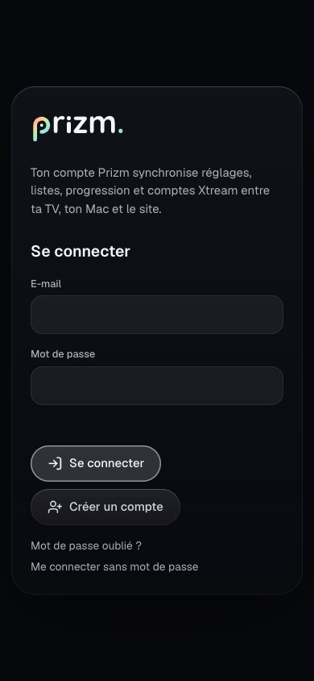
</p>

Sur la page compte : connexion par mot de passe **ou par lien reçu par e-mail** (sans mot de passe), mot de passe oublié, changement de mot de passe ou d’adresse, phrase secrète, appareils connectés, suppression du compte.

## La phrase secrète

Pour synchroniser tes **comptes Xtream**, Prizm te demande de choisir une **phrase secrète**, différente de ton mot de passe. Elle chiffre tes identifiants Xtream **sur l’appareil**, avant tout envoi : le serveur de Prizm ne reçoit qu’un bloc illisible, et personne d’autre que toi ne peut les lire.

- Elle est demandée **une seule fois par appareil**. La TV la reçoit automatiquement par le QR code : rien à saisir à la télécommande.
- Un mot de passe oublié ne touche pas à tes comptes Xtream.
- **Garde-la bien** : sans elle, il faudra ressaisir tes comptes Xtream. Tu peux la changer depuis un appareil où elle est déjà ouverte.

## Connecter la TV (QR code)

<p align="center">
  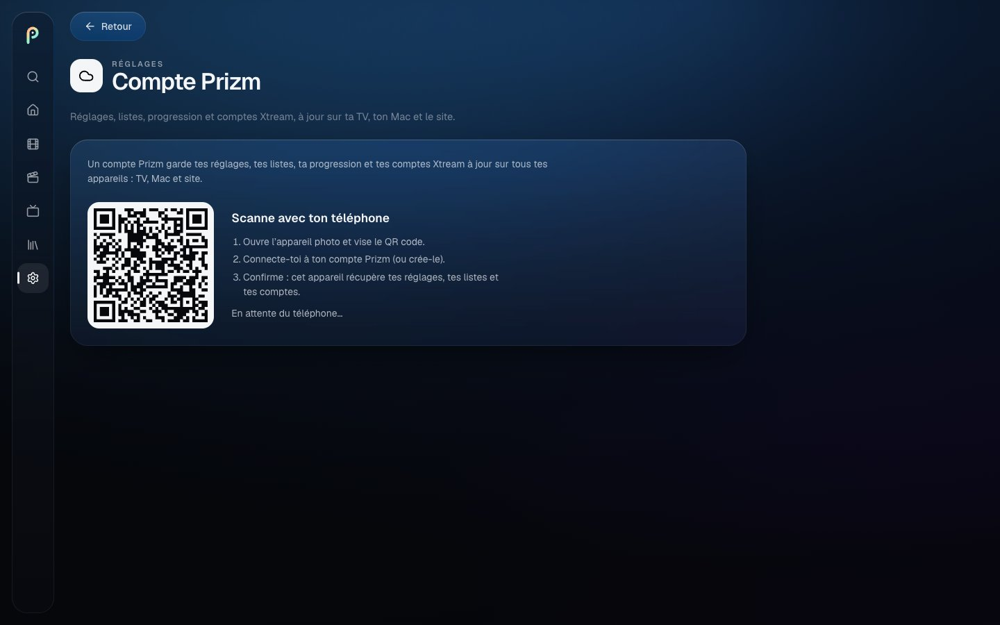
</p>

1. Sur la TV : **Réglages → Compte Prizm** (ou, au premier lancement, **J’ai un compte Prizm**).
2. Vise le QR code avec l’**appareil photo de ton téléphone** : la page prizm.exro.cool/lier s’ouvre.
3. Connecte-toi (ou crée ton compte), puis **Connecter**. Si ta phrase secrète n’est pas encore ouverte sur le téléphone, la page te la demande.
4. La TV se connecte toute seule et récupère tes réglages, tes listes, ta progression et tes comptes Xtream.

> Pas de téléphone sous la main ? **Me connecter avec mon e-mail** permet de saisir e-mail et mot de passe à la télécommande.

## Connecter le Mac

<p align="center">
  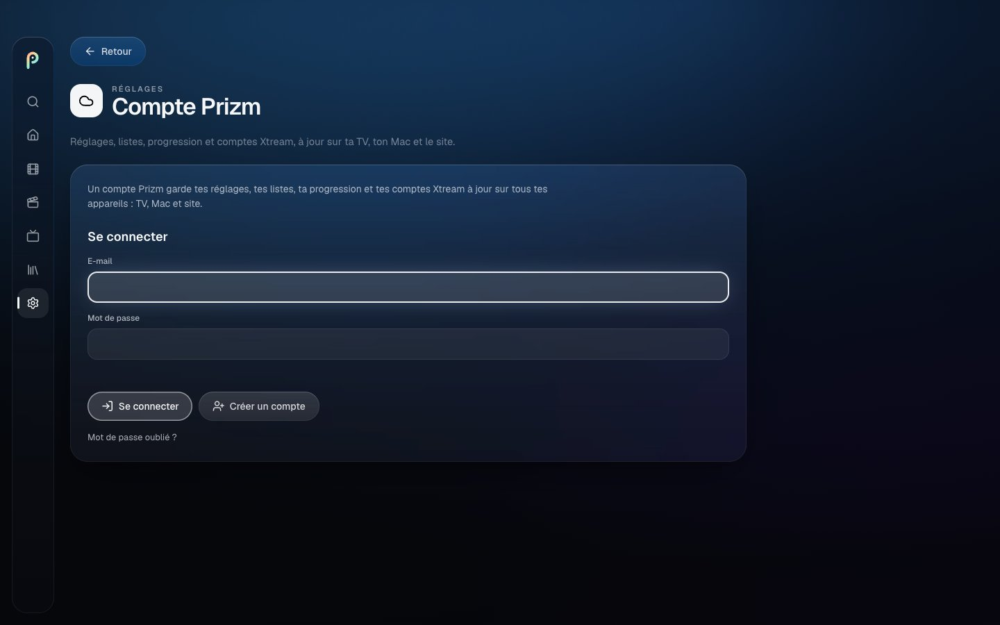
</p>

**Réglages → Compte Prizm** : saisis ton e-mail et ton mot de passe, puis ta phrase secrète. Tes comptes Xtream arrivent aussitôt.

## Appareils connectés

Sur la page compte (et dans **Réglages → Compte Prizm**), la liste de tes TV et Mac connectés, avec leur dernière activité. **Déconnecter** un appareil (prêté, vendu, perdu) lui retire l’accès au compte : il se déconnecte et efface les comptes Xtream qu’il avait reçus.

---

## Questions fréquentes

**Le premier chargement est long.**
C’est normal avec un gros catalogue, et il n’a lieu qu’une fois. Le compteur montre l’avancée ; les lancements suivants partent du catalogue gardé sur l’appareil.

**Un film ne se lance pas (« Lecture interrompue »).**
Choisis **Essayer l’autre lecteur**. Si rien ne passe, le fichier est probablement indisponible chez ton fournisseur.

**Une chaîne coupe ou rame.**
Prizm essaie déjà tout seul les autres versions de la chaîne. Tu peux aussi choisir une qualité plus basse avec la pastille **Qualité**, ou régler la qualité par défaut dans **Réglages → Live TV**.

**La navigation n’est pas fluide.**
Passe en **effets légers** (Réglages → Apparence) et mesure avec le compteur d’images.

**Je ne trouve pas un titre de la filmographie d’un acteur.**
S’il n’est pas chez ton fournisseur, il apparaît grisé dans « Filmographie complète ». OK l’ajoute à « À regarder », et Prizm le retrouvera s’il arrive au catalogue.

**Mes identifiants Xtream sont-ils envoyés quelque part ?**
Sans compte Prizm : non, ils restent sur l’appareil et ne servent qu’à joindre ton serveur IPTV. Avec un compte Prizm : ils sont envoyés **chiffrés de bout en bout** avec ta phrase secrète, illisibles pour le serveur de Prizm.

**Mac : « Prizm.app est endommagé » ou « Apple n’a pas pu confirmer… ».**
C’est l’autorisation de la première ouverture, voir [Première ouverture : l’autorisation de macOS](#première-ouverture--lautorisation-de-macos).

**Mac : un film met quelques secondes à démarrer.**
C’est le cas des fichiers dont le son est converti (AC3, DTS…) : ffmpeg prépare le début du flux. Un déplacement dans la vidéo relance la conversion à la nouvelle position.

**J’ai oublié ma phrase secrète.**
Dans **Réglages → Compte Prizm** (ou sur la page compte), **J’ai oublié ma phrase secrète** efface les comptes Xtream synchronisés et te laisse en choisir une nouvelle. Les comptes déjà présents sur cet appareil repartent aussitôt, chiffrés avec la nouvelle phrase. Sur tes autres appareils, déconnecte-toi puis reconnecte-toi au compte Prizm.

**L’e-mail de confirmation n’arrive pas.**
Regarde dans les indésirables, puis utilise **Renvoyer l’e-mail de confirmation** à la connexion.

---

<sub>Prizm par exr0. Ce produit utilise l’API TMDB sans être approuvé ni certifié par TMDB. Polices Geist et Quicksand sous licence SIL Open Font License.</sub>
